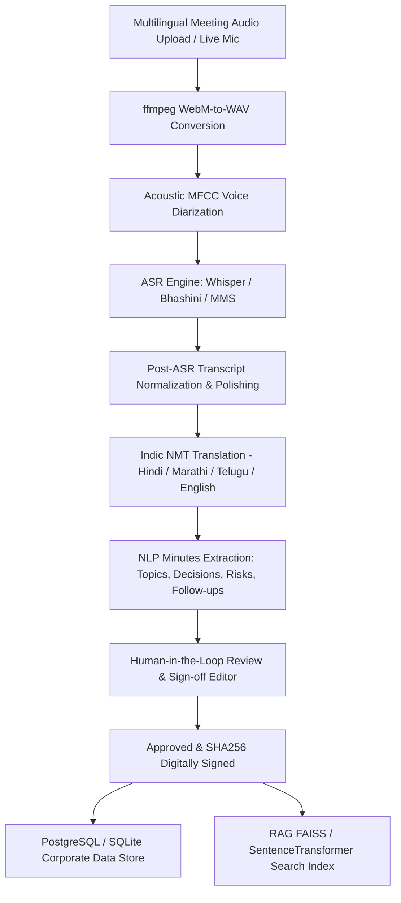

# Corporate AI Meeting Minutes & Transcripts Platform

Corporate AI Meeting Minutes & Transcripts Platform is an enterprise-ready, AI-powered corporate governance and meeting intelligence platform. The application converts multilingual meeting audio into structured, searchable, translated, and legally auditable corporate meeting minutes, featuring a human-in-the-loop review dashboard, executive demographic & department analytics, acoustic speaker diarization, cryptographic audit trail, and a RAG-based AI retrieval chatbot.

---

## Technical Architecture

The platform is split into a modular FastAPI backend and Next.js client codebase:



### Folder Structure

```
├── backend/
│   ├── app/
│   │   ├── core/           # Configs, DB sessions, Pydantic settings
│   │   ├── services/       # AI pipeline, Acoustic Diarization, Bhashini, RAG, Audit
│   │   ├── routers/        # Auth, Meetings, Audio, Attendance, Chat, Analytics, Audit, Translation
│   │   ├── models.py       # SQLAlchemy Schema definitions
│   │   ├── schemas.py      # Pydantic Schemas
│   │   ├── main.py         # FastAPI Entrypoint
│   │   └── seed_data.py    # Database Seeder
│   ├── tests/              # API and RAG Pytests
│   ├── Dockerfile
│   └── requirements.txt
├── frontend/
│   ├── app/                # Next.js App Router pages and layouts
│   │   ├── components/     # DevToolsProtector, AudioPlayer, Navbar, Modals
│   │   ├── record/         # Live Meeting Recorder View
│   │   ├── verify/         # Side-by-side Human-in-the-Loop Review Editor
│   │   ├── attendance/     # Role-Based Meeting Attendance & Pass Kiosk
│   │   └── analytics/      # Department & Budget Analytics
│   ├── tailwind.config.js  # Custom Tokens & Dark Mode Theme
│   ├── next.config.js      # Production Security Headers
│   ├── tsconfig.json
│   └── Dockerfile
├── docker-compose.yml      # Multi-container service definitions
└── README.md
```

---

## Core Features

1. **Corporate RBAC & HttpOnly Authentication**: Implements JSON Web Tokens (JWT) issued via secure HttpOnly cookies for Roles: `System Admin`, `CEO`, `Manager`, and `Employee`.
2. **True Acoustic Voice Diarization**: Uses `librosa` to extract 20 Mel-Frequency Cepstral Coefficients (MFCCs) and `scikit-learn` Agglomerative Clustering on physical voice timbre, identifying physical speaker shifts independent of pauses.
3. **Multi-Engine ASR (Whisper / Bhashini / MMS)**: Transcribes meeting audio using local `openai/whisper-small` or MeitY's official **Bhashini ASR API** with fallback to Meta MMS-1B.
4. **Post-ASR Transcript Normalization & Polishing**: Automatically filters speech stutters, vocal fillers (`um`, `uh`, `like`, `you know`), restores proper punctuation, and normalizes grammar.
5. **Dynamic Indic NMT Translation**: Live neural machine translation of summaries, agendas, and diarized transcript segments into Hindi (हिंदी), Marathi (मराठी), Telugu (తెలుగు), and English.
6. **Attendance Verification (GPS Geofence + QR Pass)**: Validates mobile check-ins using Haversine formula distance verification from Corporate Headquarters.
7. **AI Minutes Extraction**: Extracts structured executive summaries, key topics, decisions, issues & risks, follow-ups, financial budget allocations, and action item deadlines.
8. **Side-by-side Verification Editor**: Allows Meeting Hosts and Managers to review, edit, and align transcript dialogue turns before executive sign-off.
9. **Cryptographic SHA256 Audit Trail**: Finalizing minutes computes an immutable SHA256 digital signature hash in the audit log ledger.
10. **RAG Semantic Search Chatbot**: Employs Sentence Transformers and vector similarity indexes to fetch past meeting resolutions with exact citation details.
11. **Corporate Analytics Dashboard**: Visual metrics displaying department representation, speaking time distribution, action item statuses, and budget allocations.
12. **Client & Server Hardening**: Features client-side DevTools protection (`DevToolsProtector` blocking F12, inspect element, right clicks, and anti-debugging loops), CORS restrictions, and security HTTP headers (`HSTS`, `X-Frame-Options`, `X-Content-Type-Options`).

---

## Getting Started (Commands to Run)

### Option 1: Running Locally with Python & Node.js

#### 1. Backend Setup:
```bash
cd backend
python3 -m venv ../venv
source ../venv/bin/activate
pip install -r requirements.txt

# Run FastAPI server
DATABASE_URL=sqlite:///./sql_app.db uvicorn app.main:app --port 8000 --reload
```

#### 2. Frontend Setup:
```bash
cd frontend
npm install
npm run dev
```
Access the application at `http://localhost:3000`.

---

### Option 2: Running via Docker Compose

From the root project directory, run:
```bash
docker-compose up --build
```
This builds and launches:
- **PostgreSQL** on port `5432`
- **FastAPI Backend** on port `8000` (Swagger docs at `http://localhost:8000/docs`)
- **Next.js Frontend** on port `3000`

To seed sample corporate data:
```bash
docker-compose exec backend python app/seed_data.py
```

---

## Verification & Testing

To execute the automated test suite:
```bash
PYTHONPATH=backend ./venv/bin/pytest backend/tests -v
```
