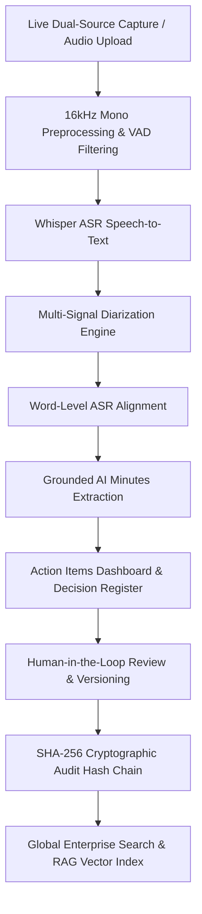

# Enterprise AI Meeting Operating System & Governance Platform

**Enterprise AI Meeting Operating System** is a multi-tenant, AI-powered corporate meeting intelligence, execution tracking, and cryptographic governance platform. The system captures live dual-source audio (microphones & browser tab audio) or audio uploads, applies **multi-signal speaker diarization** and Whisper ASR transcription, generates **grounded AI meeting minutes**, tracks **action items & corporate decisions**, enforces **multi-version document approvals**, and seals records with **cryptographic SHA-256 audit hash chains**.

---

## 🏛️ System Architecture



### 📁 Project Folder Structure

```
├── backend/
│   ├── app/
│   │   ├── core/           # Configuration, Database Sessions, Pydantic Settings
│   │   ├── services/       # Multi-Signal Diarization Engine, Audio Preprocessor, ASR Aligner, RAG
│   │   ├── routers/        # Auth, Meetings, Action Items, Decisions, Audio, Minutes, Translation, Search, Analytics, Audit
│   │   ├── models.py       # SQLAlchemy Schema (Organization, Department, Decision, ActionItem, MinutesVersion)
│   │   ├── schemas.py      # Pydantic Schemas & Data Transfer Objects
│   │   ├── main.py         # FastAPI Entrypoint & Router Registry
│   │   └── seed_data.py    # Database Seeder (Organizations, Decisions, Action Items)
│   ├── tests/              # Pytest Backend Unit & Integration Suite
│   └── requirements.txt
├── benchmarks/
│   ├── speaker_change_cases/# 12 Controlled Diarization Benchmark Scenarios
│   └── evaluate.py         # Standardized DER & Diarization Scorecard Evaluator
├── frontend/
│   ├── app/                # Next.js App Router pages
│   │   ├── action-items/   # Action Items Execution Dashboard
│   │   ├── decisions/      # Corporate Decision Register
│   │   ├── meetings/       # Meeting Schedule & Live Launcher Registry
│   │   ├── verify/         # Review & Sign Studio & Speaker Timeline
│   │   ├── components/     # SpeakerTimelineView, LiveMeetingCaptureView, AuthView
│   │   ├── lib/            # API client bindings & Translation dictionary
│   │   └── layout.tsx      # Main layout with single-page tab navigation
│   ├── tailwind.config.js  # Theme Tokens & Dark Mode Config
│   └── next.config.mjs     # Security Headers & Next.js Build Settings
├── docker-compose.yml      # Multi-container orchestration
└── README.md
```

---

## ✨ Key Enterprise Capabilities

### 1. 🧠 Multi-Signal Speaker Diarization Engine (`diarization_engine.py`)
- **7-Signal Decision Matrix**: Computes speaker transitions using `Embedding Discontinuity`, `Local Acoustic Boundary`, `Energy Transition`, `VAD Signal`, `Speaker Profile Distance`, `Temporal Consistency`, and `Cluster Consistency`.
- **Adaptive Threshold Calibration**: Dynamically computes meeting-specific acoustic thresholds ($\mu + k \cdot \sigma$) to handle noisy boardrooms or virtual calls.
- **Temporal Confirmation**: Classifies transition boundaries into `CONFIRMED` ($\ge 85\%$), `PROBABLE` ($\ge 65\%$), or `UNCERTAIN` ($< 65\%$) to eliminate false speaker changes during pauses.
- **Centroid Profile Memory**: Maintains long-term speaker centroid vectors to correctly track speaker re-entry ($A \rightarrow B \rightarrow A$) even after 60+ seconds of silence.

---

### 2. 🎯 Action Items Execution Dashboard (`/action-items`)
- **Kanban & List Matrix**: Sorts deliverables into `To Do`, `In Progress`, `Completed`, and `Overdue`.
- **Source Evidence Jumping**: Every task card includes a **`🔍 View Source Evidence`** link that jumps directly to the exact meeting ID and audio timestamp where the action item was assigned.
- **Priority & Confidence Badges**: Tracks priority (`HIGH`, `MEDIUM`, `LOW`), owner assignment, department, and AI extraction confidence score ($95\%$).

---

### 3. 📜 Corporate Decision Register (`/decisions`)
- **Governance Ledger**: Tracks executive architectural, financial, policy, and operational sign-offs.
- **Rationale & Signatories**: Displays decision statements, underlying rationale, impact level, and verified signatories.
- **Source Verification**: 1-click jump to transcript segment and speaker audio source.

---

### 4. 🔬 "Why Speaker Change?" Diarization Diagnostic Inspector
- **Explainable Diarization UI**: Interactive **`💡 Why Speaker Change?`** button in `SpeakerTimelineView.tsx` (`/verify`).
- **7-Signal Progress Gauges**: Displays dynamic engine sub-scores for embedding discontinuity, acoustic spectral boundary, VAD transition, energy shift, profile mismatch, and cluster consistency.

---

### 5. 🔒 Cryptographic SHA-256 Audit Hash Chain
- **Chained Hashing**: Enforces audit log hashing where `hash_n = SHA256(record_n + hash_{n-1})`.
- **Public Verifier Endpoint**: `GET /api/v1/audit/verify/{meeting_id}` recomputes the entire audit trail and flags any historical tampering.

---

### 6. 🔍 Global Enterprise Search (`/search?query=...`)
- **Cross-Entity Search**: Queries Decisions, Action Items, Meetings, Transcripts, and RAG vector store simultaneously.
- **Structured Response**: Returns categorized results with timestamp links and evidence quotes.

---

## 🧪 Benchmark Suite & Evaluation

Run the 12 controlled diarization benchmark cases:
```bash
PYTHONPATH=backend ./venv/bin/python benchmarks/evaluate.py
```

Run the backend Pytest unit and integration test suite:
```bash
PYTHONPATH=backend ./venv/bin/pytest backend/tests -v
```

---

## 🚀 Quickstart Guide

### 1. Launch FastAPI Backend
```bash
cd backend
PYTHONPATH=backend ./venv/bin/uvicorn app.main:app --host 0.0.0.0 --port 8000 --reload
```
API Documentation available at: `http://localhost:8000/docs`

### 2. Launch Next.js Frontend
```bash
cd frontend
npm run dev
```
Web Platform available at: `http://localhost:3000`
