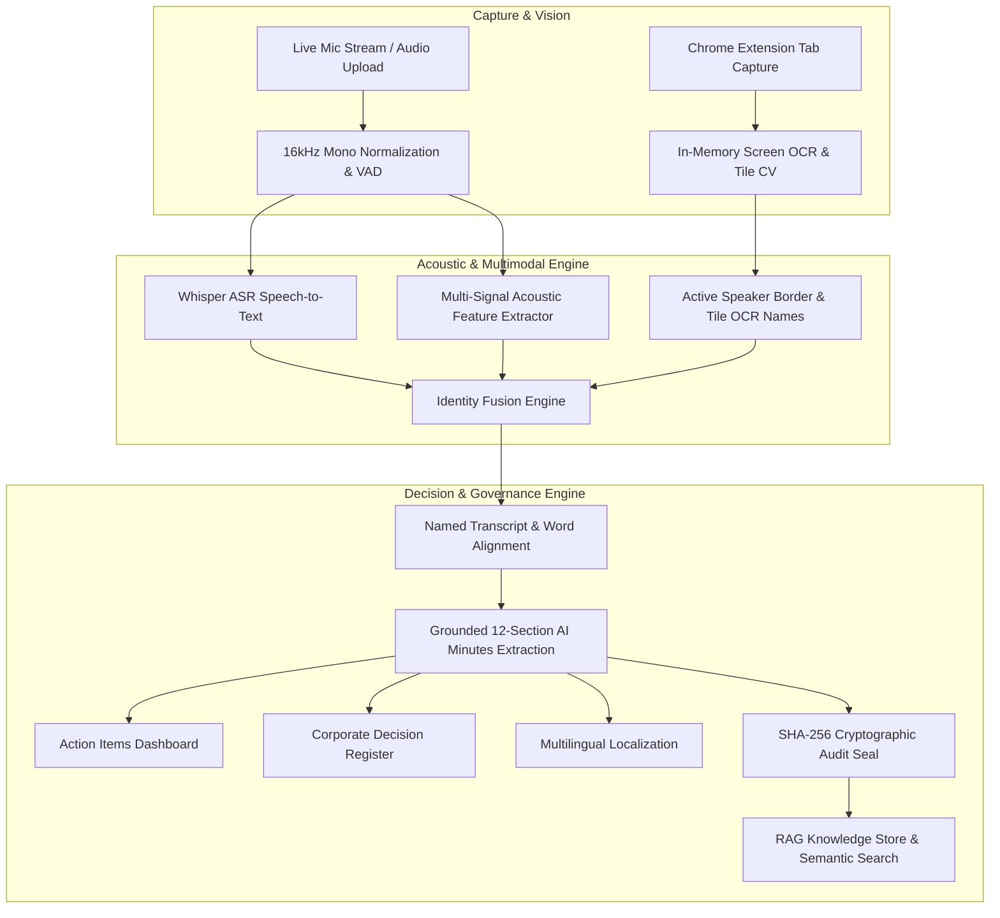

# Enterprise AI Meeting Intelligence & Governance Operating System

[](https://fastapi.tiangolo.com)
[](https://nextjs.org)
[](https://python.org)
[](https://www.typescriptlang.org)
[](https://pytorch.org)
[](https://tailwindcss.com)
[](#)

> **Enterprise AI Meeting Operating System** is a production-grade, multi-tenant corporate meeting intelligence, execution tracking, and cryptographic governance platform. It features **dual-source live audio capture**, **in-memory screen OCR active-speaker computer vision**, **9-signal multimodal identity fusion**, **biometric voice calibration**, **grounded 12-section AI meeting minutes**, and **SHA-256 cryptographic audit sealing**.

---

## 🏛️ System Architecture



---

## 🧠 AI & Machine Learning Model Zoo

| Category | Model / Pipeline | Deployment / Engine | Purpose |
| :--- | :--- | :--- | :--- |
| **Speech Recognition (ASR)** | `openai/whisper-small` / `whisper-tiny` | Local HuggingFace Transformers | Sub-second word timestamping, multilingual ASR, and language identification. |
| **Indic Speech Recognition** | `ai4bharat/whisper-medium-{lang}-gpu` | Bhashini Dhruva National Pipeline | Government-grade ASR for Indic languages (Hindi, Marathi, Telugu, Tamil, etc.). |
| **Speaker Diarization** | `pyannote/speaker-diarization-3.1` | PyAnnote Audio + 124-Dim MFCCs | Overlapping speech detection, boundary detection, and speaker clustering. |
| **Acoustic Embeddings** | Custom 124-Dim Feature Extractor | Librosa + NumPy + SciPy | 20-band MFCCs, Delta, Delta-Delta, Spectral Centroid, and Zero-Crossing Rate. |
| **Clustering Engine** | Agglomerative Clustering | Scikit-learn (Ward Linkage) | Hierarchical distance clustering with adaptive cosine thresholds. |
| **Computer Vision (OCR)** | Tesseract OCR (`pytesseract` 0.3.10) | In-Memory Ephemeral Engine | Screen OCR for participant video tiles (Google Meet, Zoom, MS Teams). |
| **Tile & Border Tracking** | OpenCV (`cv2`) + Pillow (`PIL`) | Real-time Contour & Luminance | Grid layout segmentation and active speaker glowing border detection. |
| **Meeting Minutes LLM** | Google `gemini-1.5-flash` / `gemini-1.5-pro` | Google Generative AI SDK | 12-section structured executive minutes, action items, risks, and decisions. |
| **Secondary LLM Fallback** | OpenAI `gpt-4-turbo` / `gpt-3.5-turbo` | OpenAI API (Structured JSON Mode) | High-accuracy structured JSON fallback for minutes extraction. |
| **Offline Local NLP** | Custom Rule-Based NLP Parser | Local Python Engine | Deterministic, 100% grounded minutes extractor operating with zero cloud API keys. |
| **Semantic Search & RAG** | `sentence-transformers/all-MiniLM-L6-v2` | SentenceTransformers (PyTorch) | 384-dimensional dense semantic vectors for AI Chatbot and RAG assistant. |
| **Neural Translation (NMT)**| `ai4bharat/indictrans2-indic-en` / `en-indic` | Bhashini Dhruva NMT Service | Enterprise translation across Indian scheduled languages. |
| **Fallback Translation** | Google Translate Engine | `deep-translator` | Dynamic real-time minutes localization (English, Hindi, Marathi, Telugu). |

---

## 💻 Full Technical Stack

### **Frontend Client**
* **Framework**: Next.js 14.2 (App Router) with React 18 & TypeScript 5.4.
* **Styling**: Tailwind CSS 3.4 with custom dark/light glassmorphic tokens.
* **Componentry & Icons**: Lucide React (`lucide-react`) enterprise icon set.
* **Analytics & Graphs**: Recharts 2.12 for interactive speaker timelines and attendance analytics.
* **Audio Visualization**: HTML5 Web Audio API Canvas visualizer with real-time waveform rendering.

### **Backend Application**
* **API Framework**: FastAPI 0.139 running on Uvicorn 0.51 ASGI server.
* **Language Runtime**: Python 3.10+ / 3.14.
* **Data Modeling & Validation**: Pydantic v2 (`pydantic-settings`) with strict schema validation.
* **Database & ORM**: SQLAlchemy 2.0 with SQLite (`sql_app.db`, WAL-mode) / PostgreSQL compatibility.
* **Authentication & RBAC**: JWT tokens (`python-jose`, HS256) with salted bcrypt password hashing.
* **Cryptographic Ledger**: SHA-256 chained hashing (`hashlib`) for tamper-evident digital sealing.
* **Test Suite**: Pytest 8.2 with `pytest-asyncio` (54 automated unit & integration tests).

### **Chrome Extension (Manifest V3)**
* **Service Worker**: `background.js` managing tab audio streams, capture states, and API transport.
* **Content Script**: `content.js` + `content.css` injecting floating recording widgets into Google Meet, Zoom, and Teams.
* **Capture APIs**: `chrome.tabCapture`, `chrome.storage`, HTML5 MediaRecorder API.

---

## ✨ Core Platform Capabilities

### 1. Multimodal OCR + Voice Identity Fusion (`identity_fusion.py`)
Fuses **9 distinct multimodal signals** to assign true human identities to transcript turns:
1. **Calibrated Voice Profile Matching**: Cosine similarity against enrolled biometric speaker centroids.
2. **In-Memory Screen OCR Presence**: Corroborates attendee presence from conference video tiles.
3. **Active Visual Speaker Highlight**: Detects active speaker bounding borders on video tiles.
4. **Rule B2 Dialogue Content Attribution ("What they say")**:
   - *Technical Demonstrations*: Identifies primary presenters from architectural phrasing.
   - *Prompter/Coordination*: Identifies coordinators from countdown cues (*"3, 2, 1, go"*).
   - *Self-Introductions*: Direct attribution on *"I am <Name>"*, *"This is <Name>"*, *"<Name> speaking"*.
5. **3-Tier Classification Guardrail**:
   - `MATCHED`: $\ge 0.72$ confidence.
   - `AMBIGUOUS`: $0.55 - 0.72$ confidence (flags for human review).
   - `UNKNOWN`: $< 0.55$ confidence (protects against false assignments).

### 2. In-Memory Ephemeral Screen OCR (`screen_ocr.py`)
- **Zero Raw Video Disk Storage**: Video frames are analyzed entirely in volatile RAM and immediately discarded.
- **Adaptive Grid Detection**: Dynamically segments 1x1, split, 2x2, 2x3, and 3x3 meeting grids.
- **Automated Attendance Registry**: Directly populates meeting participant rosters and check-in logs.

### 3. Biometric Voice Calibration Studio (`/voice-profiles`)
- **Anti-Replay Challenge Phrases**: Randomizes dynamic prompts to eliminate audio replay attacks.
- **Signal Quality Gatekeeper**: Enforces SNR $\ge 10\text{ dB}$, clipping $\le 3\%$, and speech activity $\ge 40\%$.
- **Profile Drift Protection**: Exponential Moving Average (EMA) updates with consent ledger compliance.

### 4. Grounded 12-Section AI Meeting Minutes
Extracts structured executive meeting documentation linked directly to verbatim audio evidence:
1. Executive Summary & Meeting Purpose
2. Confirmed Attendance & Quorum Status
3. Key Agenda & Discussion Topics
4. Strategic Decisions & Approvals
5. Action Items & Deliverables (with owners and ISO 8601 deadlines)
6. Issues, Risks & Mitigation Strategies
7. Questions & Answers Log
8. Unresolved Items & Next Steps
9. Financial & Budgetary Approvals
10. Departmental Breakdowns
11. Verbatim Transcript Evidence Linkage
12. Cryptographic Digital Hash Seal

### 5. Action Items Dashboard & Decision Register
- **Action Items Dashboard (`/action-items`)**: Kanban and list views with real-time status tracking (`To Do`, `In Progress`, `Completed`, `Overdue`) and **`🔍 View Source Evidence`** timestamp links.
- **Decision Register (`/decisions`)**: Executive governance catalog tracking signatories, rationale, policy impact, and audio proof.

### 6. RAG Assistant & Enterprise Semantic Search
- **AI Chatbot (`/chat`)**: Multi-turn conversational interface powered by `all-MiniLM-L6-v2` dense embeddings.
- **Citation-Backed Verification**: Answers include exact meeting references, timestamps, and confidence percentages.

---

## 📁 Repository Structure

```
├── backend/
│   ├── app/
│   │   ├── core/                  # Configuration, database connection, JWT settings
│   │   ├── models.py              # SQLAlchemy schemas (Meetings, Transcripts, Minutes, Participants)
│   │   ├── schemas.py             # Pydantic data transfer objects
│   │   ├── main.py                # FastAPI application entrypoint
│   │   ├── routers/               # Modular REST API endpoints
│   │   │   ├── screen_ocr.py      # Video frame OCR & attendance sync
│   │   │   ├── audio.py           # Audio upload, ASR, and live streaming
│   │   │   ├── meetings.py        # Meeting management & scheduling
│   │   │   ├── minutes.py         # Minutes generation & versioning
│   │   │   ├── action_items.py    # Action item CRUD & status tracking
│   │   │   ├── decisions.py       # Corporate decision register
│   │   │   ├── voice_calibration.py# Voice profile enrollment & calibration
│   │   │   ├── chat.py            # RAG semantic chatbot assistant
│   │   │   ├── translation.py     # Multilingual NMT translation
│   │   │   ├── search.py          # Global cross-entity search
│   │   │   ├── audit.py           # SHA-256 audit ledger & verification
│   │   │   └── analytics.py       # Executive intelligence analytics
│   │   └── services/              # Core algorithmic engines
│   │       ├── identity_fusion.py # Multimodal OCR + Voice Identity Fusion Engine
│   │       ├── screen_ocr.py      # Ephemeral in-memory OCR & CV border detection
│   │       ├── diarization_engine.py # 9-signal multi-signal diarizer
│   │       ├── ai_pipeline.py     # Whisper ASR, Gemini/OpenAI/NLP extractor
│   │       ├── voice_calibration.py # Biometric sample evaluator & composite builder
│   │       ├── audio_preprocessor.py# FFmpeg 16kHz mono normalization & VAD
│   │       ├── asr_aligner.py     # Word-level timestamp alignment
│   │       ├── bhashini.py        # MeitY Indic ASR & NMT service
│   │       ├── rag.py             # SentenceTransformers vector search
│   │       └── audit.py           # Cryptographic hashing & report generator
│   ├── tests/                     # 54 comprehensive unit & integration tests
│   └── requirements.txt           # Python dependency specifications
├── frontend/
│   ├── app/                       # Next.js App Router
│   │   ├── page.tsx               # Primary dashboard & navigation controller
│   │   ├── layout.tsx             # Root enterprise navigation layout
│   │   ├── action-items/          # Action items Kanban dashboard
│   │   ├── decisions/             # Corporate decision ledger
│   │   ├── meetings/              # Meeting list & live capture studio
│   │   ├── components/            # Specialized UI modules
│   │   │   ├── meeting/MinutesReviewStudio.tsx # Review & Sign Studio
│   │   │   ├── meeting/LiveMeetingCaptureView.tsx # Dual live streamer
│   │   │   ├── meeting/SpeakerCalibrationView.tsx # Voice profile enrollment
│   │   │   └── meeting/SpeakerTimelineView.tsx # Explainable diarization inspector
│   │   └── lib/                   # API client layer & translation dictionaries
│   ├── package.json
│   └── tailwind.config.js
├── extension/                     # Chrome Extension (Manifest V3)
│   ├── manifest.json              # Extension manifest & permissions
│   ├── background.js              # Service worker audio capture & sync
│   ├── content.js                 # Floating meeting capture widget
│   ├── popup.html                 # Extension popup launcher
│   └── README.md
├── docker-compose.yml             # Container orchestration
└── README.md                      # Platform documentation
```

---

## 🚀 Quickstart Guide

### Prerequisites
- **Python**: 3.10+ (Python 3.11 or 3.12 recommended)
- **Node.js**: 18.x or 20.x
- **FFmpeg**: Required for audio transcoding (`brew install ffmpeg` or `sudo apt-get install ffmpeg`)
- **Tesseract OCR**: Required for native screen OCR (`brew install tesseract` or `sudo apt-get install tesseract-ocr`)

### 1. Backend Setup
```bash
cd backend

# Create and activate virtual environment
python3 -m venv venv
source venv/bin/activate

# Install dependencies
pip install -r requirements.txt

# Launch FastAPI development server
PYTHONPATH=. uvicorn app.main:app --host 0.0.0.0 --port 8000 --reload
```
* Interactive Swagger API Docs: `http://localhost:8000/docs`
* ReDoc Specification: `http://localhost:8000/redoc`

### 2. Frontend Setup
```bash
cd frontend

# Install Node dependencies
npm install

# Start Next.js development server
npm run dev
```
* Web Dashboard: `http://localhost:3000`

### 3. Chrome Extension Installation
1. Open Google Chrome and navigate to `chrome://extensions/`.
2. Enable **Developer mode** (top-right toggle).
3. Click **Load unpacked** and select the `/extension` directory.
4. Open Google Meet, Zoom Web, or Microsoft Teams — the floating capture widget will appear automatically.

---

## 🧪 Automated Testing

The backend includes a comprehensive suite of 54 unit and integration tests covering identity fusion, screen OCR, diarization, cryptographic auditing, and minutes generation.

```bash
# Run the complete test suite
PYTHONPATH=backend ./venv/bin/pytest backend/tests -v
```

---

## 🔒 Security, Privacy & Enterprise Compliance

* **Ephemeral In-Memory OCR Processing**: Video conference frames are buffered strictly in volatile RAM for OCR name extraction and active speaker contour detection. No raw video frames are ever persisted to disk.
* **Cryptographic Tamper-Evidence**: Meeting minutes and approvals are chained via SHA-256 digests. Any alteration to meeting topics, decisions, or attendees invalidates the digital seal.
* **Biometric Consent Ledger**: Calibrated voice embeddings require explicit user consent flags (`CONSENT_GRANTED`) before voice matching can be triggered.
* **Role-Based Access Control (RBAC)**: Enforces role checks (`System Admin`, `CEO`, `Manager`, `Director`, `Employee`) across review, sign-off, and export endpoints.

---

## 📄 License
Enterprise Proprietary — Developed for Enterprise Meeting Intelligence & Cryptographic Governance.
